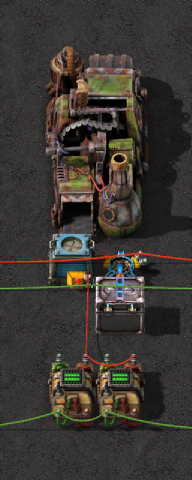
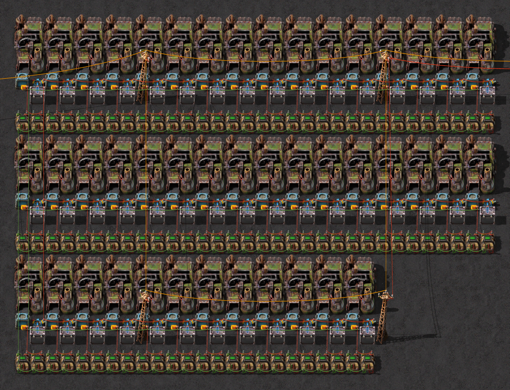
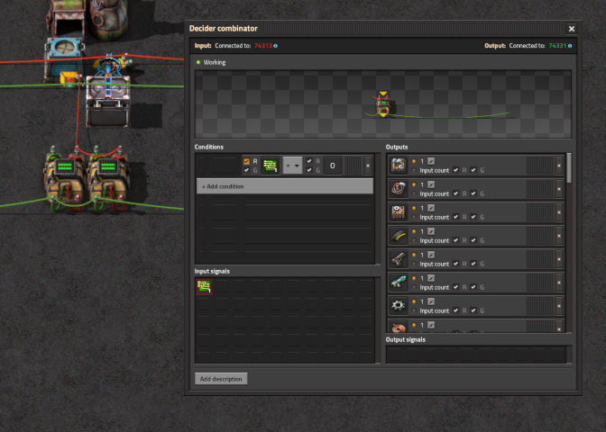
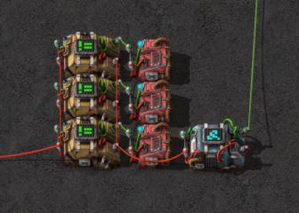
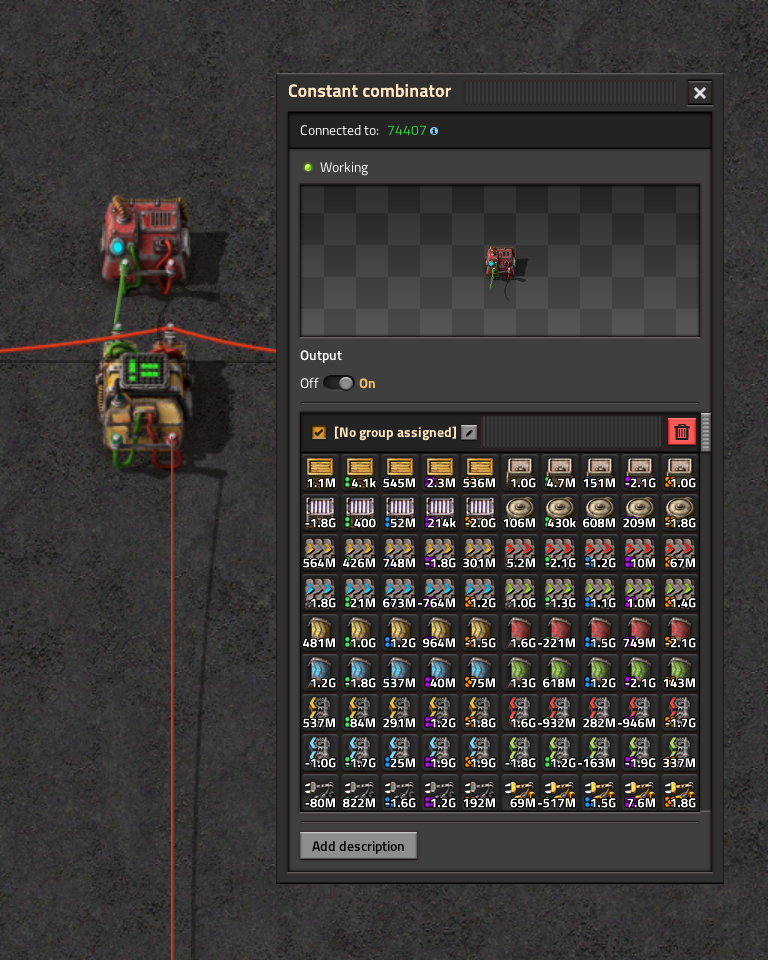
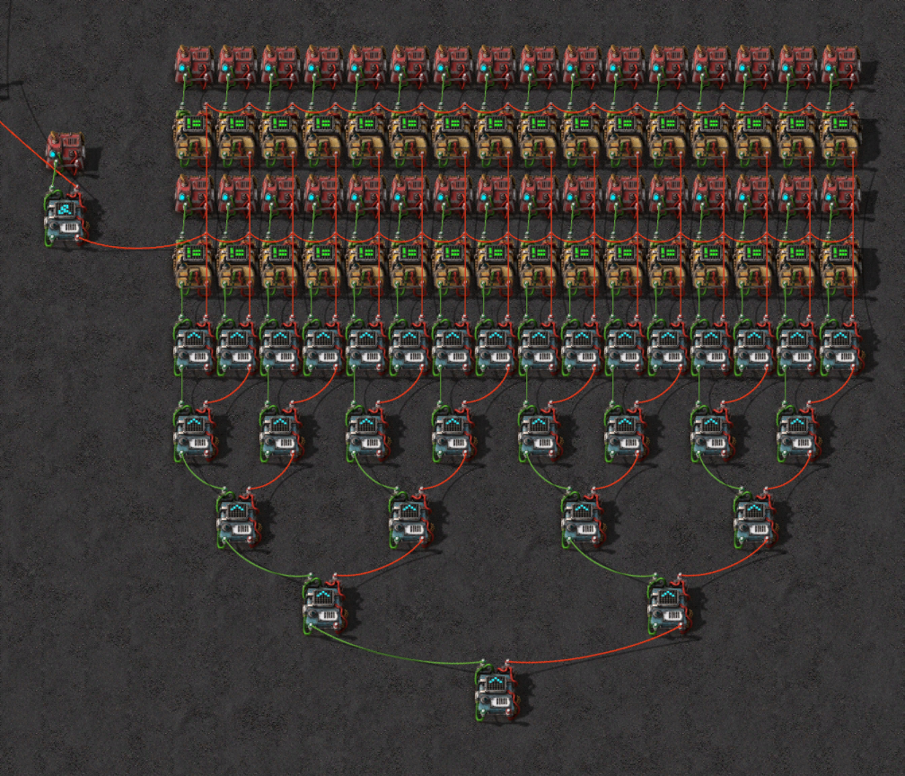
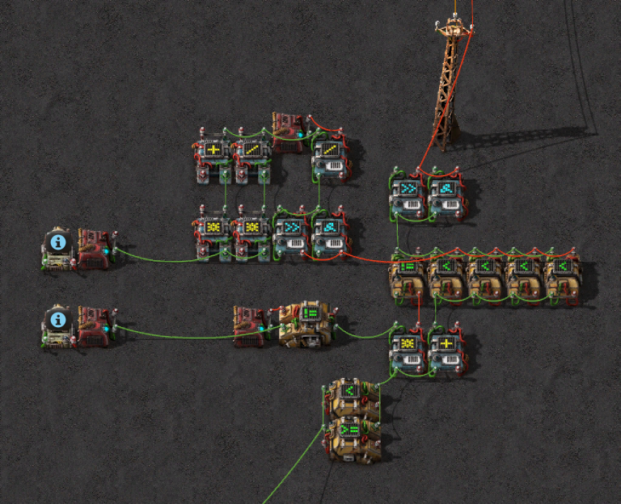

<script>
  import {LFSR, SymbolicLFSR} from './factorio-rng/lfsr'
  import QualityCalculator from './factorio-rng/quality-calculator'
  import EntropyTable from './factorio-rng/entropy-table'
  import Foldout from '$lib/components/Foldout.svelte'
  import rngplot from "./factorio-rng/img/expected_bits_plot.svg?raw"
  import PMatrix from "./factorio-rng/matrix"
  import Katex from '$lib/components/Katex.svelte'

  let sharedLfsrState = $state(0b110000);
</script>


<video autoplay loop muted playsinline style="width: 100%; height: auto; border-radius: var(--radius-3);" poster="./factorio-rng/img/factorio-breaking-rng-thumbnail.jpg">
  <source src="./factorio-rng/img/legendary-autocrafter.mp4" type="video/mp4">
</video>

<!-- How did we get here? Below I recollect my journey figuring out how Factorio's RNG works. -->

## Introduction
With the release of the Space-Age DLC in Factorio several new mechanics were introduced.
One major mechanic was the new concept of different items and building *qualities*.
By default, items are common quality, but if add *quality modules* to the crafting machine we gain a small chance to obtain items of higher quality.

What does that mean? The items / buildings get improved stats, such as faster crafting speeds, improved module buffing stats, increased power pole range and faster inserters.
Thats pretty neat, and as such we are interested in getting the highest possible quality on our items and buildings.
The original intention of the developers was to make use of the law of large numbers, wherein the more items you craft, the higher the chance that you get at least some items at higher quality levels.

However, thinking about it, one might ponder:

<p style="text-align: center;">
 <i>How</i> is it possible for a <i>deterministic</i> game like Factorio to have a <i>random</i> mechanic?
</p>

The short answer is: It isn't random.

Instead &ndash; as is common in computing &ndash; the simulation makes use of a *pseudo-random number generator* (PRNG).
A PRNG is a deterministic algorithm which produces a sequence of numbers which for all intents and purposes appears to be random.
In particular this means properties like it following a well defined distribution of outputs, which contains no discernable patterns.
Normally in computer science one can get away with treating the PRNG as just a black box function which can yield random numbers, without concerning oneself with how it actually works.
Yet by taking a look under the hood we can do something *funny*.

> [!check] **The Funny**: What happens if we know the exact algorithm **and** its internal state?
> Then we could just run the same algorithm on the state and obtain the same outputs, which will also be seen by the game internally.
> Its necessarily always the same outputs, as otherwise the chosen algorithm would not be deterministic.
> As such we can run the same computations simultaneously to the game and predict the future outputs of the PRNG,
> allowing us to predict the future "random" events which will occur in the game, such as which crafts will observe an increase in quality.

In the following sections I'll build up to that point, starting from what RNG the game uses, how it is breakable and how it can be <s>ab</s>used ingame.
The entire background should be understandable if you have a rudimentary understanding of linear algebra. That should be the only prerequisite.

## Starting from Nothing
Soooo, how does one figure out what PRNG algorithm Factorio uses?
Afterall, there are several different implementations out there they could have chosen from.

To figure this out, my first step was a rudimentary internet research.
As the Factorio community is quite large and filled with many technically inclined individuals,
*surely* someone must have asked this question before.
After digging around a bit I found a post on the Factorio forums asking basically
the same thing I wanted to know, though 11 years have passed since then.
In that thread, we also find the following answer by @Cube, a former developer at Wube. They wrote:

>[!cite] Cube - Tue Sep 30, 2014 12:27 pm - [forums.factorio.com - topic 5995](https://forums.factorio.com/viewtopic.php?t=5995)
>\[...\] We chose taus88 mainly because it is the fastest from boost's generators.
> I was thinking of removing one of the three LFSRs (that should make it about
> 40% (?) faster), but there is no point, since the random numbers are not a
> bottleneck for us.

This already gives us a lead on where to look next: the `Boost.Random` library.
There we find the following (abbreviated) implementation for the [taus88]
generator:
```cpp
typedef xor_combine_engine<
  xor_combine_engine<
    linear_feedback_shift_engine<uint32_t, 32, 31, 13, 12>, 0,
    linear_feedback_shift_engine<uint32_t, 32, 29, 2, 4>, 0>, 0,
  linear_feedback_shift_engine<uint32_t, 32, 28, 3, 17>, 0> taus88;

template<class UIntType, int w, int k, int q, int s>
class linear_feedback_shift_engine {
  // w = word size (e.g. 32 for 32 bit uint)
  // k = number of bits in the LFSR
  // q = feedback tap position
  // s = number of steps to do at once
  // wordmask() = 0b11...111; mask of w low bits set
  result_type operator()() {
    const UIntType b = (((value << q) ^ value) & wordmask()) >> (k-s);
    const UIntType mask = (wordmask() << (w-k)) & wordmask();
    value = ((value & mask) << s) ^ b;
    return value;
  }
}
```
[taus88]: https://www.boost.org/doc/libs/1_88_0/doc/html/doxygen/headers/taus88_8hpp_1a3822a73532a76cfeca0db9888d676c72.html
[lfsr]: https://www.boost.org/doc/libs/1_88_0/boost/random/linear_feedback_shift.hpp

This means that taus88 consists of 3 [`linear_feedback_shift_engine`][lfsr] whose results are XORed together.
Note that this linear feedback shift engine is more commonly referred to as *LFSR*: *linear feedback shift register*.

Though when starting the project that post was already 8 years old.
Hence, I wanted to cross-check the information given on the forum against the most
accurate source available: The game binary.

While the game itself is closed source, the developers graciously ship a `.pdb` file containing the debug symbols alongside the game binary.
This means we can generate a well-annotated decompilation of the binary to inspect the code and figure out what is going on under the hood.
To this end, I used the open source decompilation tool [Ghidra], switching to [Binary Ninja][BinaryNinja] later on in the project.
Regardless of which tool one uses, one can rather quickly find the `RandomGenerator` class in the game's code, where `getInt()` is implemented as follows:

[Ghidra]: https://github.com/NationalSecurityAgency/ghidra
[BinaryNinja]: https://binary.ninja

```cpp
uint RandomGenerator::getInt(RandomGenerator *this) {
  uint a = this->seed1;
  uint b = this->seed2;
  uint c = this->seed3;

  a = (a << 12 ^ a >> 6) & 0x1fff ^ a >> 19 ^ a << 12;
  b = (b << 4 ^ b >> 23) & 0x7f ^ b >> 25 ^ b << 4;
  c = (c << 17 ^ c >> 8) & 0x1fffff ^ c >> 11 ^ c << 17;

  this->seed1 = a;
  this->seed2 = b;
  this->seed3 = c;

  return a ^ b ^ c;
}
```

The first thing which stands out is that almost none of the constants used in the original `taus88` definition remain.
This can be attributed to the compiler performing optimizations such as constant folding to reduce the number of required operations.
Yet the fact that we store 3 seeds for our RNG state is a first strong indicator that it is indeed the same generator.
Likewise, the states are updated independently of one another, with the final result being the XOR of all three states.

To rid myself of all remaining doubt about whether the two implementations are equivalent, I rewrote both
variants in Python so they can be run using [`sympy`][sympy], a Python library for symbolic manipulation.
Advancing both variants by a single step confirms that all bits of the corresponding registers update
in the exact same fashion. I used `sympy` here because doing these equivalence checks by
hand ($3 \cdot 32 = 96$) would have been quite tedious.
> [!warning] TODO
> add link to my code which proves equivalence

[sympy]: https://www.sympy.org/

Ok, with all that established, we are certain that the RNG used in Factorio is indeed the `taus88` generator,
which itself is a combination of 3 LFSRs.
This is a very interesting result, as LFSRs are known to be quite weak PRNGs,
online one even finds the statement that they are *trivially breakable*[^trivially-breakable].

[^trivially-breakable]: *Trivially breakable* for security researchers seems to mean that *they* know how to break them hence its easy, even if still takes some setup to understand.

To understand what makes them "*weak*" and how we can exploit this weakness to predict the future RNG calls,
we first need to look at the underlying mathematics of LFSRs, which is the subject of the next section.

## LFSR Maths Review
To begin, we need to understand what the *linear feedback shift register* (LFSR) actually models.
First, consider a simple *register*.
It describes a collection of bits, aggregated into a single value $x$:
$$ 
x = x_{n-1} \dots x_2 x_1 x_0
$$
Each individual *bit* $x_i$ can be seen as a binary variable with $x_i \in \{0, 1\} = \mathbb{F}_2$.
While it is common to consider this register value $x$ to represent a number in the range $[0, 2^n~-~1] \subseteq \mathbb{Z}$,
it is more useful in our case to instead consider the register to actually describe a *vector* of individual bits, i.e. $x \in \mathbb{F}_2^n$.
Additionally, we consider two operations which operate on each individual bit:
1. $x_i \oplus y_i$: The XOR operation takes 2 bits and returns 1 if the bits differ and 0 if they are equal.
   Note that this is equivalent to *addition* modulo 2.
2. $x_i \cdot y_i$: The AND operation takes 2 bits and returns 1 if both bits are 1, otherwise it returns 0.
   This is equivalent to *multiplication* modulo 2.


Now extend that notion of a register into a *shift register*.
To shift, move all bits in the register downwards by taking each higher bit and shifting it 1 position down,
dropping the lowest bit as the output.
Here we follow the convention that the most significant bit (highest bit) is the leftmost bit $x_{n-1}$ and the least significant bit is the rightmost bit $x_0$.

You can interact with this kind of register below.
Tap the individual bits to toggle them, and use the controls to start, stop and step the registers.

<LFSR tapMask=0 bits=6 initialState=0b100001/>

Well... This is boring! We converge pretty quickly to the same value of 0 regardless of the initial state.
This does not seem random at all!
To keep our shift register from always just discarding all information we will add another component,
namely some *feedback*.
The first idea is to just loop the discarded lowest bit back into the highest bit,
as it previously had no preceding bit from which it could obtain (new) information,
while we discard information in the lowest bit.
Doing this we have basically implemented a *bit roll* operation:

<LFSR tapMask=0b100000 />

Hmmm... At least we no longer always arrive at an empty register.
But the sequence when the last bit lights up is very predictable. 
This is due to the fact that the information that we observe repeats every $n$ steps 
-- each bit remains unmodified after all!
Thanks to the low cycle length, one can again quickly spot the pattern produced by our current *feedback shift register*.
To combat this we insert some *linear feedback*, by adding the feedback not
only to the first bit, but also some intermediate bits.
Note that addition here means XOR, as we are working with individual bits:

<LFSR tapMask=0b110000/>

Unlike the last steps it might not be immediately obvious why this step is named the way it is.
It comes from the fact that the XOR $\oplus$ operation
we use to combine the feedback into the inner bits causes our bit states to be a
linear combination of the previous bit states. This linearity is also the reason 
why we can reconstruct the internal RNG state from just observations alone,
and why standalone LFSRs are cryptographically weak PRNGs.

Note that in all the cases above only the last bit was considered an output.
However, in practice it is more common to output the entire register state as the result of the RNG call.
This then allows one to reinterpret the number as a proper integer in $[0, 2^n-1]$
producing random looking numbers.

We now know how an LFSR gets constructed.
In particular, given the state $x^{(t)}$ at time $t$ we now know how to:
1. Generate the next state $x^{(t+1)}$.
2. Generate corresponding output bits, either one at a time, or as a full integer value.

> [!note]- Regarding the Cycle length of LFSRs
> 
> The cycle length of an LFSR is the number of steps it takes until the state repeats.
> For an LFSR with $n$ bits, the maximum cycle length is $2^n - 1$ (every state except the all-zero state).
> 
> LFSR mechanics are actually also modeled by polynomials over $\mathbb{F}_2$.
> A single step then corresponds to multiplying the current state $S(X) = \sum_{i=0}^{n-1} x_i X^i$
> with $X$ (this shifts the bits up one index).
> 
> Finally, by doing this modulo a feedback polynomial $P(X)$ of degree $n$ that is *primitive* (and therefore irreducible), we can ensure that the cycle length is maximal, i.e. $2^n - 1$.
> $P(X)$ then specifies to the spaces where the feedback is inserted, i.e. the bits which are XORed with the feedback bit.
> In other words, not all feedback configurations are equally good, and the choice of feedback taps is crucial to ensure a long cycle length.

### LFSRs are linear
Let us take another look at the *linearity* claim of above.
To do that rather than considering arbitrary instantiations of $x$,
i.e. states where all bits were set to either 0 or 1,
we can now consider a symbolic representation of the LFSR.
We still start at an arbitrary point in time $t=0$, at which we label each individual bit
with an additional symbolic variable $x_i$.
Then we track how the bits evolve over time as we apply the LFSR transition rules.
Each symbol is colored either on or off depending on the state at which the LFSR was started.
As before, you can toggle individual bits by clicking on them &ndash; though only while the bit labels are in the initial state.

<SymbolicLFSR tapMask=0b1100 />

We see that every bit is always just a combination of the initial bit states.
Note that whenever we observe $x_i \oplus x_i$ the $x_i$ cancels out, allowing us to remove it from the equation again.
While stepping, each instantiated bit will always stay equal to the parity of "on" bits in the symbolic combination depending on the state when we assigned the labels.
Additionally we notice that a bit is either just the preceding bit state, or it is a combination of the preceding and the feedback state.

Now what has this got to do with linearity?

First of all, note that the set of bits $\mathbb{F}_2 = \{0, 1\}$ joined with the operations $\oplus$ and $\cdot$ form a structure known as a [*field*][wiki-field]. 
This field is commonly known as the *Galois field* $\text{GF}(2)~=~\mathbb{Z}/2\mathbb{Z}~=~\mathbb{F}_2$
or the *modular arithmetic* mod 2.
A field is just a math term for a set of values joined with some operations which satisfy a certain set of properties (see below).

> [!info]- Field properties of $(\mathbb{F}_2, \oplus, \cdot)$
> The properties which need to be satisfied to declare $(\mathbb{F}_2, \oplus, \cdot)$ a field are as follows:
> - *Associativity* (both $\oplus$ and $\cdot$): $a \oplus (b \oplus c) = (a \oplus b) \oplus c$ and $a \cdot (b \cdot c) = (a \cdot b) \cdot c$.
> - *Commutativity* (both $\oplus$ and $\cdot$): $a \oplus b = b \oplus a$ and $a \cdot b = b \cdot a$.
> - *Identity*: For $\oplus$ this is $0$: $0 \oplus a = a$ and for $\cdot$ this is $1$: $1 \cdot a = a$.
> - *Additive Inverse*: For any $a$ we have a $-a$ such that $a + (-a) = 0$. Note that here we have $a = -a$.
> - *Multiplicative Inverse*: For any $a \neq 0$ we have $a^{-1}$ such that $a \cdot a^{-1} = 1$ is trivial as the only other element is 1.
> - *Distributivity*: $a \cdot (b \oplus c) = (a \oplus b) \cdot (a \oplus c)$.
> 
> Note that these properties can easily be checked for $\mathbb{F}_2$ with truth tables,
> at most 8 rows are necessary.

Why do we care about this? 
Because having a *field* structure is a prerequisite for [*vector spaces*][wiki-vector-space].
In particular here, we consider the vector space spanning all vectors of length $n$ over the field $\text{GF}(2)$, which is denoted as $\text{GF}(2)^n$.
The operators are now applied pointwise to each coordinate of the vector using the operators from original the field $\text{GF}(2)$.
And wherever we have a vector space, we can talk about *linear* combinations of vectors.

[wiki-field]: https://en.wikipedia.org/wiki/Field_(mathematics)
[wiki-vector-space]: https://en.wikipedia.org/wiki/Vector_space#Definition_and_basic_properties

<!-- 
> [!note]- Galois Field $\text{GF}(p)$
> If $p \in \mathbb{N}$ is a prime number, then $\text{GF}(p) = \mathbb{F}_p = \mathbb{Z}/p\mathbb{Z}$ is a field.
> 
> $\mathbb{Z}/p\mathbb{Z}$ consists of elements which can be written in the form
> $[a + bp]$ where $a \in \{0, 1, \dots, p-1\}$ and $b \in \mathbb{Z}$.
> Elements with the same $a$ but different $b$ are considered equivalent.
> This forms the so called *modular arithmetic* where we can do addition and
> multiplication as follows for $a,b,c \in \mathbb{Z}$ : 
> $$
> \begin{align*}
>  a+b      &\equiv c \mod p \iff \exists k \in \mathbb{Z}: a + b = c + kp \\
>  a\cdot b &\equiv c \mod p \iff \exists k \in \mathbb{Z}: a\cdot b = c + kp
> \end{align*}
> $$ -->

Personally, after getting an introduction into linear algebra and vector spaces within that abstract framework,
I subsequently only ever saw them applied to either $\mathbb{R}^n$ or, if spicy, to $\mathbb{C}^n$.
However, the original definition of a vector space is kept very generic on purpose!
It allows *any* structure which satisfies the necessary properties to be manipulated in the same way,
enabling us to apply well-known algorithms that you may have only seen applied to systems described by
$\mathbb{R}^{m \times n}$ matrices to arbitrary matrices, regardless of the underlying field $F$.[^maths-naming]
And as luck would have it, the previously defined operations XOR and AND on the bits span a *field*!

[^maths-naming]: 
  This is basically the mathematical variant of programming using generics, where we can write algorithms which work for any type which satisfies the necessary properties.
  And just like in generic programming, the naming often sucks :) But it somehow stuck... 

Taking another look at the symbolic example, we can reformulate each individual bits transition as a *linear* combination of previous bit states:
$$
\begin{align*}
x_3^{(t+1)} &= x_0^{(t)} \\
x_2^{(t+1)} &= x_3^{(t)} \oplus x_0^{(t)} \\
x_1^{(t+1)} &= x_2^{(t)} \\
x_0^{(t+1)} &= x_1^{(t)}
\end{align*}
$$
Since we can write the entire state as a vector of these bits, and each transition is *linear* itself,
this means we can write the transition between the current state 
$s^{(t)} \in \text{GF}(2)^n$ to the next state $s^{(t+1)} \in \text{GF}(2)^n$
as a *matrix product*:
$$
s^{(t+1)} = T s^{(t)}
$$
where $T \in \text{GF}(2)^{n \times n}$. 
Note that like the bits in the state vector, each individual entry in the matrix is a value in $\text{GF}(2)$,
i.e. it's either 0 or 1.
In particular this allows us to visualize this matrix as a bitmap, where a bright entry means a 1 and a dark pixel represents a 0.
For the 6 bit wide toy LFSRs we saw previously, this looks as follows:

<div style="display:flex; gap: 1em; flex-wrap: wrap; justify-content: center;">
  <PMatrix src="./factorio-rng/img/matrix_toy.png" --pmatrix-width="15%" width=6 height=6 --color-active="var(--accent-1)"/>
</div>

This mathematical notation allows us to start rewriting some operations in a more compact way.
The most notable of them is the ability to advance the LFSR by multiple steps at once in compact notation:
$$
s^{(t+k)} = T s^{(t+k-1)} = T^2 s^{(t+k-2)} = \dots = T^k s^{(t)}
$$
Now that we have seen a bunch of theory, we can actually apply it to the above code snippets.
Focusing on a single LFSR component we have:
```cpp
a = (a << 12 ^ a >> 6) & 0x1fff ^ a >> 19 ^ a << 12;
```

This can be written out for each individual bit and evaluated.
In turn we obtain a system of 32 equations, as each LFSR is defined over `uint32_t` words, which have 32 bits.
Note that some of the bits are actually redundant due to the construction of the LFSRs in the taus88 library: $k$ the LFSR size is always chosen smaller than $w$ the word size.

<Foldout>
<Katex displayMode latex={String.raw`\begin{array}{rrrrrrrrc}
a_{31}' = \big((& a_{19} &\oplus& 0     ) \cdot 0\big) \ \oplus& 0      &\ \oplus&  a_{19} =&                & a_{19} \\
a_{30}' = \big((& a_{18} &\oplus& 0     ) \cdot 0\big) \ \oplus& 0      &\ \oplus&  a_{18} =&                & a_{18} \\
a_{29}' = \big((& a_{17} &\oplus& 0     ) \cdot 0\big) \ \oplus& 0      &\ \oplus&  a_{17} =&                & a_{17} \\
a_{28}' = \big((& a_{16} &\oplus& 0     ) \cdot 0\big) \ \oplus& 0      &\ \oplus&  a_{16} =&                & a_{16} \\
a_{27}' = \big((& a_{15} &\oplus& 0     ) \cdot 0\big) \ \oplus& 0      &\ \oplus&  a_{15} =&                & a_{15} \\
a_{26}' = \big((& a_{14} &\oplus& 0     ) \cdot 0\big) \ \oplus& 0      &\ \oplus&  a_{14} =&                & a_{14} \\
a_{25}' = \big((& a_{13} &\oplus& a_{31}) \cdot 0\big) \ \oplus& 0      &\ \oplus&  a_{13} =&                & a_{13} \\
a_{24}' = \big((& a_{12} &\oplus& a_{30}) \cdot 0\big) \ \oplus& 0      &\ \oplus&  a_{12} =&                & a_{12} \\
a_{23}' = \big((& a_{11} &\oplus& a_{29}) \cdot 0\big) \ \oplus& 0      &\ \oplus&  a_{11} =&                & a_{11} \\
a_{22}' = \big((& a_{10} &\oplus& a_{28}) \cdot 0\big) \ \oplus& 0      &\ \oplus&  a_{10} =&                & a_{10} \\
a_{21}' = \big((& a_{9}  &\oplus& a_{27}) \cdot 0\big) \ \oplus& 0      &\ \oplus&  a_{9}  =&                & a_{9}  \\
a_{20}' = \big((& a_{8}  &\oplus& a_{26}) \cdot 0\big) \ \oplus& 0      &\ \oplus&  a_{8}  =&                & a_{8}  \\
a_{19}' = \big((& a_{7}  &\oplus& a_{25}) \cdot 0\big) \ \oplus& 0      &\ \oplus&  a_{7}  =&                & a_{7}  \\
a_{18}' = \big((& a_{6}  &\oplus& a_{24}) \cdot 0\big) \ \oplus& 0      &\ \oplus&  a_{6}  =&                & a_{6}  \\
a_{17}' = \big((& a_{5}  &\oplus& a_{23}) \cdot 0\big) \ \oplus& 0      &\ \oplus&  a_{5}  =&                & a_{5}  \\
a_{16}' = \big((& a_{4}  &\oplus& a_{22}) \cdot 0\big) \ \oplus& 0      &\ \oplus&  a_{4}  =&                & a_{4}  \\
a_{15}' = \big((& a_{3}  &\oplus& a_{21}) \cdot 0\big) \ \oplus& 0      &\ \oplus&  a_{3}  =&                & a_{3}  \\
a_{14}' = \big((& a_{2}  &\oplus& a_{20}) \cdot 0\big) \ \oplus& 0      &\ \oplus&  a_{2}  =&                & a_{2}  \\
a_{13}' = \big((& a_{1}  &\oplus& a_{19}) \cdot 0\big) \ \oplus& 0      &\ \oplus&  a_{1}  =&                & a_{1}  \\
a_{12}' = \big((& a_{0}  &\oplus& a_{18}) \cdot 1\big) \ \oplus& 0      &\ \oplus&  a_{0}  =&                & a_{18} \\
a_{11}' = \big((&     0  &\oplus& a_{17}) \cdot 1\big) \ \oplus& a_{31} &\ \oplus&      0  =& a_{17}\ \oplus & a_{31} \\
a_{10}' = \big((&     0  &\oplus& a_{16}) \cdot 1\big) \ \oplus& a_{30} &\ \oplus&      0  =& a_{16}\ \oplus & a_{30} \\
a_{9}'  = \big((&     0  &\oplus& a_{15}) \cdot 1\big) \ \oplus& a_{29} &\ \oplus&      0  =& a_{15}\ \oplus & a_{29} \\
a_{8}'  = \big((&     0  &\oplus& a_{14}) \cdot 1\big) \ \oplus& a_{28} &\ \oplus&      0  =& a_{14}\ \oplus & a_{28} \\
a_{7}'  = \big((&     0  &\oplus& a_{13}) \cdot 1\big) \ \oplus& a_{27} &\ \oplus&      0  =& a_{13}\ \oplus & a_{27} \\
a_{6}'  = \big((&     0  &\oplus& a_{12}) \cdot 1\big) \ \oplus& a_{26} &\ \oplus&      0  =& a_{12}\ \oplus & a_{26} \\
a_{5}'  = \big((&     0  &\oplus& a_{11}) \cdot 1\big) \ \oplus& a_{25} &\ \oplus&      0  =& a_{11}\ \oplus & a_{25} \\
a_{4}'  = \big((&     0  &\oplus& a_{10}) \cdot 1\big) \ \oplus& a_{24} &\ \oplus&      0  =& a_{10}\ \oplus & a_{24} \\
a_{3}'  = \big((&     0  &\oplus& a_{9} ) \cdot 1\big) \ \oplus& a_{23} &\ \oplus&      0  =& a_{9} \ \oplus & a_{23} \\
a_{2}'  = \big((&     0  &\oplus& a_{8} ) \cdot 1\big) \ \oplus& a_{22} &\ \oplus&      0  =& a_{8} \ \oplus & a_{22} \\
a_{1}'  = \big((&     0  &\oplus& a_{7} ) \cdot 1\big) \ \oplus& a_{21} &\ \oplus&      0  =& a_{7} \ \oplus & a_{21} \\
a_{0}'  = \big((&     0  &\oplus& a_{6} ) \cdot 1\big) \ \oplus& a_{20} &\ \oplus&      0  =& a_{6} \ \oplus & a_{20} 
\end{array}`}/>
</Foldout>

Mapping the toy example process to the actual LFSRs which occur in taus88 we obtain the following 3 transition matrices $T_1, T_2, T_3$ which map to of one of the three generators respectively.
We again can visualize these matrices as bitmaps, where a bright pixel corresponds to a 1 and a dark pixel corresponds to a 0.
In them we also nicely see the independence from the lowest $w-k$ bits, as they appear as empty columns in the transition matrix.

<figure>
  <div style="display:flex; gap: 1em; flex-wrap: wrap; justify-content: center;">
    <PMatrix src="./factorio-rng/img/matrix_fwd_1_A.png" --pmatrix-width="25%" width=32 height=32 --color-active="var(--accent-1)"/>
    <PMatrix src="./factorio-rng/img/matrix_fwd_1_B.png" --pmatrix-width="25%" width=32 height=32 --color-active="var(--accent-2)"/>
    <PMatrix src="./factorio-rng/img/matrix_fwd_1_C.png" --pmatrix-width="25%" width=32 height=32 --color-active="var(--accent-3)"/>
  </div>
  <figcaption>Transition matrices <Katex latex="T_1, T_2, T_3"/> for the 3 LFSRs.</figcaption>
</figure>

### Inverting an LFSR
Going forward quickly is already nice.
Going backwards though, that is where the real shenanigans occur.
Since should we then somehow observe enough outputs of the RNG, we could then infer the full state just from the observed data, which then allows us to run the LFSR in a separate process to predict the future RNG calls.

Careful observation of the original construction of the LFSRs already highlights that this transition matrix *needs* to be invertible.
If you want to try it yourself, think about how you would step each bit backwards immediately after going one step forwards, and what the different cases are that come up.
Consider the same toy LFSR as shown above:
<LFSR tapMask=0b110000 value={sharedLfsrState} onStateChange={(newVal) => sharedLfsrState = newVal} hideOutput />

By simply modifying the way in which the data flows, a new variant can be constructed, 
which allows us to run the same LFSR but in reverse.
These changes originate from the following considerations:
1. In the "*forwards mode*" each step sets the topmost bit $x_{n-1}$ to the previous state's bottommost bit value $x_0$.
   As such, to get the value back into the lowest bit position, simply reverse that arrow.
   This means the feedback arrow now originates from the topmost bit $x_{n-1}$ instead.
1. If a bit is just shifted from above with no XOR between, then
   this step is reversible by just flipping the direction of the shift.
   No further modification is necessary.
2. However, if the bit is a combination of both the upper bit and feedback bit, 
   then we reverse the step by computing $x_{i+1}^{(t+1)} = x_{n-1}^{(t)} \oplus {x_i}^{(t)}$.
   Visually this is consistent with the first step, where we reversed the feedback bit origin,
   keeping all XORs at the same locations, feeding them with the new source value.
   This will cancel out the feedback state added in the forwards mode, and reverse the shift as though no modification happened.

In simpler terms, this amounts to us just flipping almost all arrows from the previous
LFSR diagram to obtain the following "*reverse mode*" LFSR:
<LFSR tapMask=0b110000 value={sharedLfsrState} onStateChange={(newVal) => sharedLfsrState = newVal} reverse hideOutput />

In mathematical terms what we have just shown is that if $T$ exists which corresponds to a single forwards step,
then we can always construct another matrix $T^{-1}$ which perfectly reverses the previous step.
i.e. we have found an inverse:
$$ 
T^{-1} T = I
$$

As such, for any given $T$ originating from an LFSR we know that $T^{-1}$ exists.
This can then either be generated by the construction above, or alternative methods
such as [Gaussian elimination](https://en.wikipedia.org/wiki/Gaussian_elimination).
Usually for Gaussian elimination we only transform the matrix into an upper triangular matrix.
However in $GF(2)$ without any numeric issues we can directly solve for the inverse matrix using following pseudo code:

```python
def invert(M):
  # Extend with the identity matrix on the right
  system = [M | I]
  # Iterate over all columns in the original M
  col = 0
  for row in M.num_rows:
    # Find pivot row, which hasn't previously been applied
    for pivot_row in range(row, M.num_rows):
      if system[pivot_row][col] == 1:
        break
    # Move the pivot to the current row
    system.swap_row(pivot_row, row)
    # Cancel all other rows with a 1 in the current column
    for cancel_row in range(M.num_rows):
      if system[cancel_row][col] == 1 and cancel_row != row:
        system[cancel_row] += system[row]
    # Move to the next column
    col += 1
  # Return the part which was previously the identity
  return system.I
```

> [!note] Regarding the Invertibility of $T_i$ in taus88
> If we consider the LFSRs as given by the boost library - and the parameters
> used to instantiate them - we will notice that they operate on $n=32$ bit words,
> while the actual LFSR sizes are 31, 29 and 28 respectively. This means that a
> couple of bits are unaccounted for. In this case these are the least significant
> bits, which will just be copies of the bits the LFSR would have previously
> output - or in terms of the linear equations: the least significant bits are
> linearly dependent on the higher significant bits.
> 
> This causes the matrices $T_i$ to have a $\text{rank}(T_i) < 32 = n$ which in
> turn means that they are strictly speaking **not** invertible.
> This is also why the pictures above show some empty columns for the least significant bits.
> 
> **HOWEVER:** As we know the lower bits to always just be linear combinations
> of the higher bits, we can reduce the transition matrices of the individual
> LFSRs to $31\times31$, $29\times29$ and $28\times28$ respectively, restoring
> the full rank (and my claim that the transition matrices are invertible by construction).
> If these reduced matrices are then used to compute the internal state from the
> observed outputs, we can compute the remaining lower bits from the values of the
> higher bits, allowing us to restore the full state. This is not strictly necessary
> to do, as should we decide to simply step the computed state as is (e.g. with
> the linearly dependent bits filled to 0) then we will obtain the true state
> of all bits after a single step forward, as this will include computing the
> linear combination of the higher bits for the lower bits.


### Combining multiple LFSRs
We've seen that we can solve the state of a single LFSR as a linear equation of
the form $Ax=b$ where all components are computed modulo 2. Remember, however, that
the full RNG result is determined by 3 independent LFSRs whose output we XOR together.
We can model this as having 3 different states $s_1, s_2, s_3 \in \text{GF}(2)^n$
each with a corresponding transition matrix $T_1, T_2, T_3$. If we then stack all
these state vectors together, we obtain a big vector 
$s = [s_1 \quad s_2 \quad s_3]^\top$ describing the entire state at once.
For this new state vector we can again derive a transition matrix which we know to be invertible:
$$
s^{(t+1)} =
\begin{bmatrix}
s_1^{(t+1)} \\ s_2^{(t+1)} \\ s_3^{(t+1)}
\end{bmatrix}
=
\begin{bmatrix}
T_1  & 0 & 0 \\ 0 & T_2 & 0 \\ 0 & 0 & T_3
\end{bmatrix}
\begin{bmatrix}
s_1^{(t)} \\ s_2^{(t)} \\ s_3^{(t)}
\end{bmatrix}
= T s^{(t)}
$$

To obtain the final result $o^{(t)} \in \text{GF}(2)^n$ from the current 
"*hidden state*" $s^{(t)}$ of the RNG we can then simply calculate:

$$
o^{(t)} = \begin{bmatrix}I  &  I  &  I\end{bmatrix} s^{(t)}
$$

where $I \in \text{GF}(2)^{n \times n}$ is the corresponding identity matrix 
(i.e. 1's along the diagonal, 0 everywhere else). If we just look at this, we
might think that the entire thing turned non-invertible again. And this would be
true, if we only look at a single output. But what happens if we step the random generator
multiple times? The first output stays as it was, the next are:
$$
\begin{align*}
o^{(t+1)} &= \begin{bmatrix}I  &  I  &  I\end{bmatrix} s^{(t+1)} \\
&=
\begin{bmatrix}I  &  I  &  I\end{bmatrix}
\begin{bmatrix} T_1  & 0 & 0 \\ 0 & T_2 & 0 \\ 0 & 0 & T_3 \end{bmatrix}
s^{(t)}\\
&= \begin{bmatrix}T_1  & T_2 & T_3\end{bmatrix}s^{(t)} 
\end{align*}
$$

and likewise:

$$
o^{(t+2)} = \begin{bmatrix}T_1^2 & T_2^2 & T_3^2\end{bmatrix}s^{(t)}
$$

Thus, we realize that if we observe 3 full outputs in a row we obtain the following
system of equations:

$$
\begin{bmatrix}o^{(t)} \\ o^{(t+1)} \\ o^{(t+2)}\end{bmatrix}
= \underbrace{\begin{bmatrix}I & I & I \\ T_1 & T_2 & T_3 \\ T_1^2 & T_2^2 & T_3^2\end{bmatrix}}_{A} s^{(t)}
$$

In other words: To figure out what the state of the PRNG registers was at any
time step $t$, we need to observe the results of 3 consecutive calls and solve
the linear system of equations: 
$$
s^{(t)} = A^{-1} \begin{bmatrix}o^{(t)} \\ o^{(t+1)} \\ o^{(t+2)}\end{bmatrix}
$$

## Implementation Hurdles

The earlier result of inverting the observation matrix $A$ already works. In fact,
it was the first solver implementation I built in Python.
For the observations, I used the Factorio Lua API to generate 3 consecutive
random numbers. That was enough to recover the internal state and
predict future RNG outputs; see: [First recording of the method working](https://youtu.be/4DblzCYfArU)

Before we try to implement it with only the available resources in-game, we still have to inspect two theoretical hurdles:
1. Currently we need the result of **consecutive calls**.
   These might not be available to us.
2. Moreover, the **full result width** i.e. all 32 bits at once of the PRNG calls are required for our observations.
  With pure game mechanics, these are not necessarily observable.

As such, let's take a look at both of these issues, and how we can address them.

### Consecutive calls
In the previous derivation we utilized the states $s^{(t)}$, $s^{(t+1)}$ and $s^{(t+2)}$
which correspond to using the full width of 3 *consecutive* calls.
As we are not necessarily the only system in the simulation requesting
RNG values at any given time, we need to consider a non-isolated case.
There are several ways to tackle this:
1. If we have a method of counting the calls made between observations, we can skip
   the non observed results by generalizing the previous result to use $o^{(t+n)}~=~T^{n} s^{(t)}$ instead,
   where $n$ is the number of calls we skipped until the next measurement.
2. Alternatively, we try to force the measurements to occur consecutively.
  This can be done by disabling all other sources in-game which can interfere
   with the measured calls, doing our necessary calls in order and computing / manipulating from there.
3. The latter can be extended further by venturing into the realm of *sub-tick mechanics*.
   Every 1/60th of a second, the game performs an update step, aka a *tick*.
   Within this tick all the simulation mechanics run in a fixed order.
   One of the triggered mechanisms is of course the creation of the crafting results within
   all machines finishing their item crafting cycle.
   If we now can harness the order in which the machines queue the item creation events,
   placing our *entropy generators* in a consecutive block within this queue,
   we force the RNG calls to be gapless, ensuring proper state reconstruction can occur.

For my implementation I chose to pursue both option 2 and 3.
The former, as it does not rely on internal update orders, is the fallback method which should *always*
work (as long as the devs do not change the RNG away from `taus88`).
Meanwhile, in theory, the latter approach allows for much faster state readout and more
robustness against extraneous outside calls.
In practice, however, it appears somewhat *flaky*, breaking at seemingly arbitrary times.

<!-- 
> [!note] On the Update Order
> Initially I believed the machines to update in reverse placement order (i.e. newest first).
> This was confirmed by pausing the game and manually placing items into the input slots,
> ensuring the machines start in the same tick.
> Neither position (cross chunk, nor tile position) nor player insertion order
> influenced the order.
>
> Later however, I discovered that different entities (inserters) placing items into
> the machines lead to a different (seemingly inconsistent) order.
> One thing I found which stabilizes this ordering is using the update order of
> separate circuit networks. As far as I can tell, they are updated in sequence
> of ascending network IDs (visible in the circuit connection page).
-->

### Full result width
For our *Entropy Generators* we will use crafting recipes which have some
randomization in their outputs.
This has the drawback that whenever we measure such an output, we do not obtain information about the
entire PRNG call. Instead, the only thing we *can* measure are some simple
questions about the output, depending on the chosen method. Some examples are:
- The number of output items. It involves randomness if either
  the recipe yields non-integer item stacks (e.g. [recycling](https://wiki.factorio.com/Recycler) recipes,
  which return 25% of the items required to craft a single input item or the item itself in case it is a self-recycle recipe),
  **or** it is a recipe with inherently random outputs (e.g. [uranium processing](https://wiki.factorio.com/Uranium_processing),
  where there is a 0.7% chance of a U-235 being produced and a 0.7% chance of *not* producing a U-238).
- The quality level of the output. We can measure if it rose in level,
  and if yes by how many at once.

I'm going to focus on the first of the two methods, just observing the amount of
produced items &ndash; as this was the only source of information I had available when
I started this project. The thing to realize is that answering any of these
questions yields us only information about some of the *top bits* of the RNG
roll result.

Let's stick with the example of refining uranium ore into U-235 and U-238.
For this we have 2 production results:
- U238 occurs with 99.3% probability as a result and
- U235 with a 0.7% chance.

<!-- TODO: maybe add the `collectMaterials` code here -->
To generate both outputs, the RNG is queried twice for a single crafting cycle. 
Once per item to generate two consecutive RNG calls.
Because these probabilities are very extreme, we gain important knowledge whenever the low-probability event occurs.
The resulting item gets generated if the respective inequality holds,
where $r_i \in [0, 2^{32}-1]$ is the computed RNG roll:
$$
\begin{alignat*}{}
r_1 \leq \left\lfloor 0.993 \cdot 2^{32} \right\rfloor &=\;& 4\,264\,902\,524_{10} &&= 11111110\ 00110101\ 00111111\ 01111100_2\\
r_2 \leq \left\lfloor 0.007 \cdot 2^{32} \right\rfloor &=\;&     30\,064\,771_{10} &&= 00000001\ 11001010\ 11000000\ 10000011_2
\end{alignat*}
$$

In particular: 
- If U238 **was not** generated, i.e. $r_1$ is greater than the given threshold, we know that the first 7 bits are 1.
- Likewise if U235 **was** generated, then the first 7 bits of $r_2$ have to be 0.

Otherwise, we have no meaningful information about the rolled bits.

Cool! But which recipe will yield us the highest amount of information each time it completes?
The more information we obtain with a single crafting cycle, the fewer crafts we require and the faster and more efficient we can determine the internal state.

Like we saw above, the only information we can observe is determined by the topmost bits, and whether we obtained the item or not.
If we now estimate that the rolls are actually evenly distributed, we can compute the expected amount of information gained with each roll and observation:
$$
\begin{align*}
\underbrace{0.007 \cdot 7\,\text{bit}}_{\text{no U238}} + \underbrace{0.993 \cdot 0\,\text{bit}}_{\text{U238}} &= 0.049\,\text{bit}\\
\underbrace{0.993 \cdot 0\,\text{bit}}_{\text{no U235}} + \underbrace{0.007 \cdot 7\,\text{bit}}_{\text{U235}} &= 0.049\,\text{bit}
\end{align*}
$$

This means we can expect a total of $0.098$ bits per successful crafting cycle.
If we study the above pattern a bit longer, we might notice that the number of leading bits
obtained in each positive case (i.e. where the probability is $0.7\%$) is
$\lfloor-\log_2(p)\rfloor$ where $p$ is the probability of the event occurring.
A similar thing holds for $p > 0.5$ where the result is instead leading 0 bits observed.
This allows us to compute the expected number of bits we measure for an event with probability $p$.
Overall, it can be written as:
$$
\mathbb{E}[\text{bits}] = p \left\lfloor -\log_2(p) \right\rfloor + (1-p) \left\lfloor -\log_2(1-p) \right\rfloor
$$
This function is also shown below.
Its plot indicates the following:
- The event which has the highest expected number of observed bits is situated at the even 50% split.
  At that point we can in fact always observe the most significant bit.
- While events closer to 0/1 allow us to infer more bits whenever they succeed, 
  the likelihood of the events occurring diminishes too fast,
  decreasing the total number of expected observed bits per event instead.

<!-- Expected bits plot, embed svg into this page to allow style reusage - needs to be imported above. -->
{@html rngplot}

What we just calculated can be seen as a discretized version of
[Shannon entropy](https://en.wikipedia.org/wiki/Entropy_(information_theory)).
As such, we have a measure applicable to all available recipes allowing us to identify those which yield the largest amount of information per craft.
By extracting the relevant recipe data from the raw game dump [^data_dump] we can programmatically compute the entropy for each recipe.

[^data_dump]: Factorio actually provides one with command line arguments.
  One of these is `--dump-data` which outputs a JSON file containing the processed prototypes as they are loaded in-game.
  This can then be parsed for further processing, such as extracting the various recipes.

Doing so yields the following table of recipes and their corresponding expected bits of information per craft, alongside how long each craft takes:

<figure>
  <Foldout --collapsed-height="400px">
    <EntropyTable />
  </Foldout>
  <figcaption>
    Entropy values for recipes with random results.
  </figcaption>
</figure>


As we can see, there are *waaay* better recipes for extracting information from the game.
One might think that [scrap recycling](https://wiki.factorio.com/Scrap) would yield a lot of information due to the many different items which can be produced.
Yet with a total entropy of $2.05$ it is only slightly above recipes like recycling [repair packs](https://wiki.factorio.com/Repair_pack) which have an entropy of $2$.
This is due to the fact that recycling repair packs (and similar recipes with ingredient count $= 4n+2$)
yield exactly one bit of information of the RNG output in either case,
as it creates a perfect $50 / 50$ split on whether the additional item will be created or not.
There are obviously alternative recipes such as the [oil refinery](https://wiki.factorio.com/Oil_refinery)
which has an entropy of $4.5$.
These, however, are also quite a bit more expensive and slower than repair pack recycling.

As such, I chose to implement the state readout using the repair pack recycling method, as repair packs are cheap, fast to craft, and unlocked early in-game.

## Actual Implementation
To actually implement the reversal and manipulation of the RNG, I've split the computation into the following steps:
1. **Sampling** the current RNG through observations,
2. Computing the **current internal** RNG state,
3. Predicting the **future internal** states,
4. Calculating corresponding **quality levels** for each future call, and finally
5. **Making use of** the predicted levels with some adapters.

As already alluded to in [Inverting an LFSR](#inverting-an-lfsr), we will need to compute a matrix-vector product for both of these steps.
Now the question is how do we get the matrices, and where do we get the vectors from?

### Sampling the RNG
The current state will be computed from *observations* made when recycling [repair packs](https://wiki.factorio.com/Repair_pack). 
Each recycling operation will yield exactly 2 bits of information, 1 for each resulting item.
This in turn means that we require $88/2=44$ recycling operations to have enough information to fully reconstruct the state.
As each result provides us with exactly one bit of information &ndash; the topmost bit of the RNG call &ndash; the 88 observations can be written as:
$$
o^{(t)}, o^{(t+1)}, \dots, o^{(t+87)} \in \text{GF}(2)
$$

A single unit measuring $o^{(t+2k)}$ and $o^{(t+2k+1)}$ may look as follows:

<figure>
  
  <figcaption>A single entropy measurement unit.</figcaption>
</figure>

It performs the following steps:
1. The inserter will move exactly 1 repair pack into the recycler.
2. The recycler will recycle the item, and upon completion query the RNG for 2 new integers, determining whether extra items (either 0 or 1) are produced.
3. Depending on whether the items are produced or not, they are placed into the *provider chest*.
   This chest is set to read the contents, providing the observation to the red wire.
4. These observations directly correspond to the topmost observed bits $o^{(t+k)}$ due to the 50% chance of output.
   Further processing occurs through the decider combinators below.
5. Before the next call can occur, we clear the provider chest by making use of the *trash unrequested* option, alongside the *enable/disable* signal we can send over the green wire connected to it, which temporarily pauses the auto trashing behavior when the requestor chest is disabled. Otherwise it requests no items.

The above unit will therefore always provide us with 2 bits of information.
To reconstruct the full state quickly, we copy this unit 44 times, yielding a total of 88 bits.
This then looks like:

<figure>
  
  <figcaption>All entropy units together.</figcaption>
</figure>

Of note here is the manner in which the individual units are queried.
There are 2 approaches:
1. Either each is triggered with a 1 tick delay, ensuring that they are always queried in the same order.
  This, however, requires us to not have *any* other RNG running in the meantime,
   as RNG calls which occur in between will mess up the expected ordering.
2. Alternatively, we can use same tick shenanigans.
  By splitting the red wire connecting the inserters with a 1 tick delay combinator in front of every inserter, this can be achieved.
   Connecting the inputs to the delay first creates a shared circuit network.
   Then sequentially connecting all outputs of the delays to the corresponding inserters will create a standalone network for each inserter.
   As the game needs to update the networks in some manner, I bank on the fact that
   it will iterate through the list ordered by the network ID.
   This ensures that the RNG calls all happen in the same tick, with no ticks interfering.
  Note that the wire construction can also be done using a 2-stage blueprint.

> [!note] Note - Regarding the Same Tick Behavior
> While the same tick stuff seems to work in practice, I have not actually confirmed that this is how the game works under the hood.
> It can be brittle at times, as it seems to arbitrarily break at random times.
> In those cases, simply reconstructing the wires allows it to work again.

### Determining the current state
Each unit produces only single bit observations as a result, so we need to apply a similar strategy as we did before.
This time though, we only use the first row of the linear equation defined above for computing observations from the state:
$$
P_1 \underbrace{\begin{bmatrix}T_1^k & 0 & 0 \\ 0 & T_2^k & 0 \\ 0 & 0 & T_3^k\end{bmatrix}}_{T^k}
\begin{bmatrix}s_1^{(t)} \\ s_2^{(t)} \\ s_3^{(t)}\end{bmatrix}
= o^{(t+k)}
$$
where $P_1 = [p_{1i}] \in GF(2)^{1 \times 96}$ is the first row of the matrix $P=\begin{bmatrix}I&I&I\end{bmatrix}$. 
If we now let $A_k = P_1 T^k \in \text{GF}(2)^{1 \times 96}$ be the matrix which denotes performing $k$ RNG steps followed by an observation of the topmost bit,
then we can write the observations we gather above to follow the subsequent equation:
$$
\begin{bmatrix}
\rule[3pt]{5mm}{0.2pt}\ A_0\ \rule[3pt]{5mm}{0.2pt}\\
                      \vdots\\
\rule[3pt]{5mm}{0.2pt}\,A_{87}\,\rule[3pt]{5mm}{0.2pt}
\end{bmatrix}
\begin{bmatrix}s_1^{(t)} \\ s_2^{(t)} \\ s_3^{(t)}\end{bmatrix}
=
A s^{(t)}
= 
\begin{bmatrix}o^{(t)} \\ \vdots \\ o^{(t+87)}\end{bmatrix}
$$
Now, as we consume 88 calls when we perform our observation, it would be beneficial to instead directly calculate the state the RNG will be in after our observation, rather than when we started.
This can be achieved by making use of the inverse transition matrix $T^{-1}$ which causes some shift in the time index, creating a new matrix $\tilde A$:
$$
A s^{(t)} =
A\, T^{-88} s^{(t+88)} =
\tilde A s^{(t+88)}
$$
Shifting the time $t$ to be relative to the next RNG call by means of substituting $\tilde t = t + 88$ we then arrive at the equation:
$$
\tilde A s^{(\tilde t)}=o^{(\tilde t-88,\dots,\tilde t-1)}
$$
This can be read as us computing the next internal RNG state from the previously done observations.
Now since there are only 88 bits which are actually linearly independent, we cannot compute a full inverse.
However, a pseudo-inverse will suffice.
Especially since we are interested in the states after -- for which the lowest bits are entirely described by the most significant bits.
This means that even a single step forward will deterministically set those previously unknown bits, so we are all fine.

The really neat thing about this entire endeavor is that matrix $A$ and similarly $\tilde A$ do not depend on any dynamic state.
As such, $\tilde A^{-1} \in \text{GF}(2)^{88 \times 96}$ can be precomputed in Python and subsequently used in Factorio.

Hence we only need to implement a matrix-vector multiply in $\text{GF}(2)$ in-game.
To do so, remember that any matrix-vector product can be seen as a weighted sum of the matrix columns weighted by the entries in the vector:
$$
Ax = \sum_{k=1}^n x_k [A]_k = x_1 \overset{\rightarrow}{a}_1 + \dots + x_n \overset{\rightarrow}{a}_n
$$
In this case, as we are performing our computations in $GF(2)$, all values are either 0 or 1, meaning the multiply can be represented with a simple conditional, while the sum is substituted with an XOR over all the weighted vectors:
$$
s^{(t+88)} = \bigoplus_{k=0}^{87} o^{(t+k)} \cdot [\tilde A^{-1}]_k
$$
Here $[\tilde A^{-1}]_k$ is the $k$-th column of $\tilde A^{-1}$ while $o^{(t+k)}$ is the $k$-th bit observation performed.
In practice this equation is computed in 2 parts.

First, each measurement unit computes a pointwise scalar-vector multiplication of $o^{(t+k)} \in \{0, 1\}$ and vector $[\tilde A^{-1}]_k$.
This is done via the *decider combinator* mentioned above doing "further processing".
If the resulting item was not observed ($= 0$) then the roll was above the threshold and we have $o^{(t+k)} = 1$, meaning this column needs to be accumulated otherwise it is not.
The vector $[\tilde A^{-1}]_k$ is stored in the constant outputs of the decider combinator, where only the bits which are 1 are actually output.
As such the vectors are represented by 96 different signals.

<figure>
  
  <figcaption>A single decider combinator computes a single scalar-vector multiplication.</figcaption>
</figure>

Finally we require the XOR of all these vectors to obtain the final state.
This can be achieved via implicit addition [^implicit-addition].
Summing the values of a single signal and extracting only the last bit of this sum is equivalent to taking the XOR over all of them.
As such, by wiring all decider outputs together, a single *arithmetic combinator* can perform the bit extraction by ANDing the pointwise sums with 1.

As each signal now corresponds to a single bit of the 3 32-bit LFSR states,
we can make use of a set of decider combinators to sum up all the corresponding bits of each active signal.
Thus we have 3 signals, each containing the current state of the game's RNG.

<figure>
  
  <figcaption>The final XOR reduction.</figcaption>
</figure>

[^implicit-addition]: In Factorio, when multiple devices write a signal to the wire,
  then the resulting signal value on the wire is the sum of all the individual signals.
  This means any summation can be done implicitly.

### Looking into the future
We perform a similar action to compute the future states of the individual LFSRs.
However, as all LFSR states require fewer than 32 bits, we can store the lookup table in a more compact fashion.
For each LFSR we need to compute the following:
$$
T^ks^{(t)} = s^{(t+k)}
$$
This is computed for $k=1,2,\dots,N$, where $T$ and $s$ are different between the 3 sub LFSRs.
From this we can again rewrite these matrix-vector multiplications as:
$$
s^{(t+k)} = \bigoplus_{j=1}^{32} s^{(t)}_j \cdot [T^k]_j
$$
where $[T^k]_j$ is the $j$-th column of $T^k$. These columns can be stored as 32 bit integers, as $T^k \in GF(2)^{32 \times 32}$.
Hence the skip-ahead equation can be implemented in parallel for all $k$ steps as follows:
1. Split the packed state $s^{(t)}$ into its individual bits $s_j^{(t)}$.
   Represent these as individual signals again (*arithmetic combinator* on the left).
2. The pointwise scalar vector multiplication $s_j^{(t)}$ with all the different
   vectors $[T^k]_j$ will either include all the vectors in the corresponding $k$-th state or not,
   thus we can implement this via a *decider combinator* again.
  This time, however, I store the constants in a separate *constant combinator* -- it can output more signals at once.
   I opted to predict 1000 forward steps in parallel.

<figure>
  
  <figcaption>Matrix columns for multiple <Katex latex="T^k" /> transition matrices.</figcaption>
</figure>

3. Now we have 32 nets each full with $k$ 32 bit wide values which need to be XORed together.
   Unlike before we cannot utilize the implicit addition here, 
   as the vectors are now not represented by 32 different signals but instead via a single 32 bit signal value. 
   Thus we have to use more *arithmetic combinators*.
   I've opted to use a *binary tree* to pairwise XOR sets of vectors together,
   as this is a known fast reduction strategy for prefix sums (which this is).

<figure>
  
  <figcaption>Parallel look-ahead for a single LFSR.</figcaption>
</figure>

### Quality prediction
Now that we have the next RNG call results before the actual in-game calls
happen, we need to make them usable for our purpose. This basically means implementing
some form of the `rollQuality` function from the game.
A reverse-engineered version of the function can be seen below, implemented in pseudo-C++:
```cpp
// Fixedpoint value of the module effect from -32.768 to 32.767
// e.g. 10% quality would be a value of 100
typedef EffectValue int16_t;

// Stub of relevant quality prototype fields
struct QualityPrototype {
    ID<QualityPrototype, uint8_t> id;
    ID<QualityPrototype, uint8_t> next;
    double nextProbability;
}

// Mapping from the ID<...> to QualityPrototype
PrototypeList<QualityPrototype>::indexToPrototype;

// Function which determines crafting result quality
ID<QualityPrototype, uint8_t>* QualityPrototype::rollQuality(
  ID<QualityPrototype, uint8_t> qualityID,
  EffectValue bonus, 
  RandomGenerator* generator,
  IDIndexedData<uint8_t, ID<QualityPrototype, uint8_t>> 
    const* unlockedQualities
) {
  // If no bonus, do early return -> no RNG call!
  if (bonus == 0)
    return qualityID.copy();
  
  QualityPrototype* quality = indexToPrototype[qualityID];

  // Roll the RNG exactly once
  double roll = RandomGenerator::uniformDouble(generator);

  // If roll < threshold we upgrade to the next quality
  double threshold = (double)((float)(bonus) / 100f);

  // Find highest quality which beats the threshold
  uint8_t nextIndex;
  while ((nextIndex = quality->next.id.index) != 0) {
    if (!unlockedQualities->data[nextIndex])
      break;

    // Scale by next upgrade probability, base game = 0.1
    threshold *= quality->nextProbability;
    if (roll > threshold)
      break;

    quality = indexToPrototype[nextIndex];
  }
  return quality->id.copy();
}
```

If we take a look at how the function is implemented in the game we can see that
it basically just takes the RNG roll and compares it against some thresholds. It
stops as soon as it finds a threshold which is no longer beaten by the roll.

This means that each craft which involves quality rolls will take exactly 1 RNG call.
And for each call we can compute the expected quality level by just comparing against
all the thresholds, which stay constant during the game. Thus they can be precomputed
in-game with some arithmetic combinators.

<figure>
  
  <figcaption>Computing the quality levels from RNG states in-game.</figcaption>
</figure>

The calculator below shows the required threshold for each quality level, as well
as the expected amount of each quality level for a given bonus.
Note that when the threshold exceeds $2^{32}-1$, i.e. the `uint32_t` maximum value,
we always upgrade, which is indicated by placing the thresholds in brackets.

<QualityCalculator/>

### Adapters
Yippee, we can now compute the relevant RNG outcomes before the corresponding calls even occur in-game.
Now the question is what can we do with that?
I have by now experimented with several -- what I call -- adapters,
which take in these predictions, and do some funny stuff with them.

Beginning with the first that I've implemented:
<!-- <iframe width="560" height="315" src="https://www.youtube-nocookie.com/embed/13axoDiMyGQ" title="Predicted Qualities" frameborder="0" allow="accelerometer; autoplay; clipboard-write; encrypted-media; gyroscope; picture-in-picture; web-share" referrerpolicy="strict-origin-when-cross-origin" allowfullscreen></iframe> -->
It takes the sequence of future output qualities, and displays them next to the assembler,
similar to the "Next Up Pieces" queue in *Tetris*.
Each time a craft is completed, it advances the window into the future outputs by one,
keeping the display relevant at all times.

The next one was the following:
<!-- <iframe width="560" height="315" src="https://www.youtube-nocookie.com/embed/ceQ5AuEhz30" title="Sorted Qualities" frameborder="0" allow="accelerometer; autoplay; clipboard-write; encrypted-media; gyroscope; picture-in-picture; web-share" referrerpolicy="strict-origin-when-cross-origin" allowfullscreen></iframe> -->

This one takes the same list, but instead assigns only a single crafter to fabricate the next item.
The assembler which is selected depends on the next output quality.
In turn this leads to the 5 assemblers outputting the items in a sorted fashion,
where each belt only ever carries a single type of quality, ordered from left to right in increasing quality.

Finally, the goal that I've been interested in from the get-go:
<!-- <iframe width="560" height="315" src="https://www.youtube-nocookie.com/embed/Gn1vKFUDIFE" title="Automated Legendary" frameborder="0" allow="accelerometer; autoplay; clipboard-write; encrypted-media; gyroscope; picture-in-picture; web-share" referrerpolicy="strict-origin-when-cross-origin" allowfullscreen></iframe> -->

This method encapsulates the entire prediction and crafting loop into a closed system, 
which can do the entire thing (predict and craft) autonomously.
It involved additional work to calculate how many items need to be scrapped in between crafts to skip to the relevant RNG call,
as well as enqueuing these skip counts from the predicted raw RNG results which turn sparse after thresholding,
together with feeding the future RNG predictions back into itself to extend the time horizon.


## Limitations
Now to the important part, that you may be wondering about:

<p style="text-align:center; font-style:italic;">
  Sweet! Can I use this to now do &lt;insert RNG manipulation target&gt; in <i>my</i> save-game?
</p>

The short answer: Very unlikely. Why?
For this you can dig into the following tree which shows many of the paths in the
game's code which might lead to a random call.

> [!todo] TODO
> Insert image + link to proper rng call tree here

The main takeaways from that graph are as follows:
- There are actually not that many different types of random generators which get
  used throughout the game.
- Important for our considerations is the <span style="color:green">generalRandomGenerator</span>
  which gets used by the `rollQuality` call.

Note that most of these generators have only a single instance which gets shared
across the entire `Map` object (i.e. across all surfaces you have the same state).
  
This sharing of RNG state means that we would also need to predict
the number of calls made outside of our machine between the individual cycles
to keep a consistent state.
Otherwise we quickly desync between the computed state and the actual game state.

While it's not impossible in theory to do so, it is in fact very intractable:
One would need to reimplement all the different function calls and their behaviour
enough such that the rng calls are predictable for all objects using the same generator.
At that point you are basically just reimplementing major parts of Factorio
inside of Factorio (which while interesting is not the task at hand).

A less optimal alternative is to resample from time to time,
and hope that there are not too many calls interwoven in the meantime.

However, to use this properly, the factory needs to be built with
the goal of RNG manipulation in mind, to mitigate the most common sources
of calls on the `generalRandomGenerator`. These include:
- **Mining Drill Resource Selection** - Hence all mining drills should be able to
  be turned off to place them in an idle state.
- **Fulgoran Lightning Strikes** - These occur during nighttime on Fulgora
  [about every 10 seconds per chunk](https://wiki.factorio.com/Fulgora#Lightning).
  To circumvent those calls interferring with the manipulation, it needs to be done
  during daytime there.
- **Other RNG Crafts** - Not only quality, but any recipe with a random output will
  make calls to the generator. Either implement capabilities to turn them off, or
  some method to count the number of calls made every time a craft occurs.

The following are speculation and I have not tested yet in what capacity they actually
influence the state:
- **Explosions / Fire** - This means no biters nor asteroids should be running
  into landmines, nor should there be rocket turrets or any active artillery.
- **Trees dropping Leaves** - Happens when trees are deconstructed, so no active
  agriculture towers.
- **Particles Spawning** - Particles are spawned with a random velocity, which in
  turn means that calls to the RNG are made.
  For instance **trains** consuming fuel will randomly emit puffs of smoke.
  
Another issue would be the sheer amount of computation that is necessary to keep
up with the game. For instance a single scrap recycling craft requires 12 calls
to simulate. 

## Conclusion
All in all, the RNG used in Factorio is quite weak, and even
completely reversible in its entirety within the game.
Proper exploitation, however, is quite difficult.
And once one has access to many of the required resources, it might not even be worth it anymore,
because simply increasing production pushes you into the law-of-large-numbers territory,
i.e. average production approaches expected production.

Nonetheless, this project was quite a learning experience, encompassing:
- Learning about *Galois Fields* and their combination with vector spaces.
- Reverse engineering the game binary, figuring out the relevant control flows.
  Even splurging on [Binary Ninja](https://binary.ninja/) which was so much more
  useful for reverse engineering than the open source alternative 
  [Ghidra](https://github.com/NationalSecurityAgency/ghidra), mainly due to it not crashing when trying to map the entire game binary and its subjectively easier to use API.
- Reimplementing the RNG, the matrix solver, and a parallel matrix multiplier,
  all in-game in a somewhat efficient manner.

P.S. I began this project at the end of April 2024, and finally got over being lazy
and published it more than a year later.
In the meantime someone else also posted about this on the
Factorio forums [Random number manipulation possibilities](https://forums.factorio.com/viewtopic.php?p=660560).
As far as I can tell they stopped at a similar point as I did in one of the earlier
stages in the project, that is predicting the state externally with a separate
Python script from some observations.
