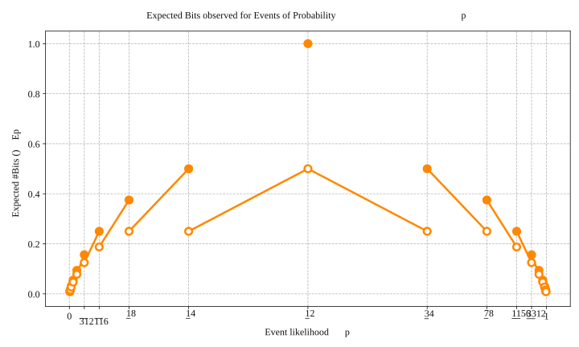

Lorem ipsum dolor sit amet, consectetur adipiscing elit. Nullam nec purus nec
$a + b$

$$
\begin{align*}
    \LaTeX &= \text{cool} \\
\end{align*}
$$
```python
import random
random.seed(0)
print(random.randint(0, 100))
```

Testing a wide div with overflow -- representing a long expression using katex.
<div style="max-width: 100%; overflow: auto;">
<div style="width: 123%; background:red;">This is a wide div</div>
</div>

<!--  -->
<script>
    import rngplot from "./factorio-rng/img/expected_bits_plot.svg?raw"
    import Matrix from "./factorio-rng/matrix"
    import Solver from "./factorio-rng/solver/solver.svelte"
</script>
{@html rngplot}

<Matrix src="./factorio-rng/img/matrix_fwd_1_mag.png"/>
<Solver />

